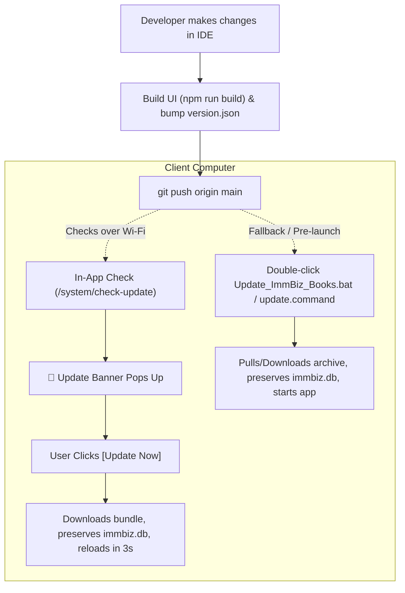

# ImmBiz Books — Local Setup & Update Guide

Complete guide for setting up and running **ImmBiz Books** on Windows and macOS, and how the zero-cost update mechanism works.

---

## Architecture & Design Highlights

```
┌────────────────────────────────────────────────────────┐
│                   ImmBiz Books App                     │
│  • React Frontend (Pre-built in frontend-react/dist)   │
│  • FastAPI Python Backend (Local Port 8000)            │
│  • SQLite Database (backend/immbiz.db) - 100% Offline   │
└──────────────────────────┬─────────────────────────────┘
                           │ (Over Wi-Fi)
                           ▼
          GitHub Repository (Zero Server Cost)
        kumarimmbizsoft-dev/local_audit (main)
```

- **100% Offline Guarantee:** Works completely offline without an internet connection. All accounting ledgers, vouchers, and companies are stored in the local SQLite database (`backend/immbiz.db`).
- **Zero Server Cost:** Updates are served directly from the public GitHub repository. No external hosting, VPS, or cloud subscription is required.
- **Zero Node.js Dependency on Client PCs:** The React frontend is pre-compiled into `frontend-react/dist` and served directly by FastAPI. End users do not need Node.js, `npm`, or Vite installed.
- **Zero Data Loss Guarantee:** All update mechanisms (in-app and desktop scripts) explicitly protect `immbiz.db` and `.env` so existing accounting records are never overwritten.

---

## Part 1: Step-by-Step Local Setup

### Option A: Windows (Client Laptop / Production User)

#### Step 1: Place the Project on the Windows PC
- Extract the ready package (e.g. `ImmBiz_Books_Windows_Ready.zip` or clone the repository):
  ```cmd
  git clone https://github.com/kumarimmbizsoft-dev/local_audit.git ImmBiz_Books
  ```
  *(Or simply copy the folder to `C:\ImmBiz_Books` or Desktop).*

#### Step 2: Create a Desktop Shortcut (Optional 1-Click)
- Inside the folder, double-click `Create_Desktop_Shortcut.bat`.
- This creates an **"ImmBiz Books"** shortcut directly on the user's Windows Desktop.

#### Step 3: Launch ImmBiz Books
- Double-click `START_WINDOWS.bat` or `Run_ImmBiz_Books.bat`.
- **What happens automatically:**
  1. Checks for Python (if not installed, automatically prompts or installs it via `winget`).
  2. Sets up a local virtual environment (`.venv`) and installs backend requirements quietly.
  3. Starts the FastAPI server on port `8000`.
  4. Automatically opens the default browser (Chrome / Edge) to `http://localhost:8000`.

#### Step 4: Log In
- **Username:** `admin`
- **Password:** `ImmBizAdmin2026!` *(or `Admin@123`)*
- Pre-seeded companies (`kumar`, `My Company`, `CAAI Demo Services`) are ready to use immediately.

---

### Option B: macOS (Mac Machine / Development)

#### Step 1: Open the Project Directory
- Navigate to the project root in Terminal or Finder:
  ```bash
  cd "/Users/j/Desktop/immiz local"
  ```

#### Step 2: 1-Click Launch
- In Finder, double-click `start.command` (or run in Terminal):
  ```bash
  ./start.command
  ```
- **What happens:**
  1. Starts the FastAPI backend on port `8000`.
  2. Starts the frontend on port `4300`.
  3. Automatically opens the browser at `http://localhost:4300`.

---

## Part 2: How Updates Work

ImmBiz Books supports two update paths: **In-App Live Updates** (while using the app) and **1-Click Desktop Updaters** (outside the app).



---

### 1. The Developer Publishing Workflow (How You Push Updates)

When you make changes to UI, backend logic, or reports:

1. **Rebuild the Frontend Bundle** (if UI changed):
   ```bash
   cd frontend-react
   npm run build
   ```
2. **Bump Version** in `version.json`:
   ```json
   {
     "version": "2.0.2",
     "channel": "stable",
     "repo": "kumarimmbizsoft-dev/local_audit"
   }
   ```
3. **Commit and Push to GitHub**:
   ```bash
   git add .
   git commit -m "Add new accounting ledger reports"
   git push origin main
   ```
*(That's it. GitHub acts as the free update server).*

---

### 2. How the Client Receives the Update

#### Method A: Automatic In-App Banner (When on Wi-Fi)
1. **Background Check:** 2 seconds after the user opens ImmBiz Books, `UpdateManager.tsx` calls `/system/check-update`.
2. **Offline Detection:** If there is no internet/Wi-Fi, the request times out safely without freezing or error alerts. The app continues running offline as normal.
3. **Update Found:** If connected to Wi-Fi and a newer commit exists on GitHub, a banner appears across the top:
   > 🚀 **New Update Available** *(Add new accounting ledger reports)* — `[ Update Now ]` `[ Remind Later ]`
4. **1-Click Apply:** When the user clicks **`[ Update Now ]`**:
   - A modal displays a progress bar.
   - The backend service (`update_service.py`) fetches the updated files.
   - **Protection Filter:** `immbiz.db`, `immbiz.db-wal`, `immbiz.db-shm`, `.env`, and `.venv` are strictly excluded from being overwritten.
   - The app reloads in 3 seconds with the new features active.

#### Method B: Manual Check via Settings
1. Go to **Settings** → **About & Updates** tab.
2. View current version, commit hash, and update channel.
3. Click **`[ Check for Updates ]`**:
   - If up to date: Notification shows *"You are on the latest version."*
   - If an update is available: Prompts the user to install immediately.

#### Method C: 1-Click Desktop Updaters (When App is Closed)
For non-technical staff who want to update before opening the app:
- **Windows:** Double-click `Update_ImmBiz_Books.bat`.
  - If Git is installed, it runs `git pull origin main`.
  - If Git is not installed, it automatically downloads GitHub's `main.zip` archive via PowerShell, extracts updated files, preserves `immbiz.db`, and launches the updated app.
- **macOS:** Double-click `update.command`.
  - Pulls updates and relaunches `start.command` with your database protected.

---

## Data Safety Guarantee Summary

| Item | What Happens During Update? |
| :--- | :--- |
| **Companies, Ledgers, Vouchers** | **100% Preserved** (`backend/immbiz.db` is never modified or replaced) |
| **System Settings & Passwords** | **100% Preserved** (`.env` is never overwritten) |
| **UI Components & Pages** | **Updated** to the latest version |
| **Backend API & Calculations** | **Updated** to the latest version |
