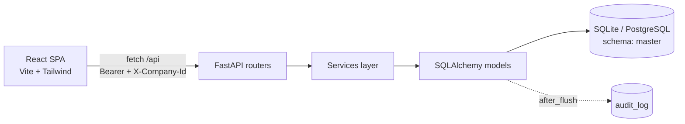

# Architecture — ImmBiz Books (CAAI FA Masters Module)

## Overview
ImmBiz Books is a full-stack Financial Accounting application implementing the
CAAI FA Master Module specification (v1.0). It covers accounting masters, vouchers,
reports, role-based access (RBAC), an immutable audit trail, multi-company data and
CSV/Excel import-export.

Modules Covered:
- Company, Ledger Groups, Ledger (chart of accounts)
- Customer / Vendor (Party) — with auto-linked ledgers
- Product / Item, Units
- Bank & Cash, GST (rates / HSN / validation), Cost Centers, Custom Fields
- Vouchers (Journal, Payment, Receipt, Sales, Purchase, Contra)
- Reports, Dashboard, unified master search
- Users, Roles, System Settings, Audit / Activity

## Tech Stack
- Frontend: React 18 + Vite 5 + Tailwind CSS 3 + TypeScript (strict)
- Backend: FastAPI + SQLAlchemy 2.0 + Pydantic v2 (Python)
- Database: SQLite (local, WAL mode) · PostgreSQL / Supabase (LAN & cloud)
- Auth: JWT (python-jose) + bcrypt
- Deployment: Vercel serverless; FastAPI also serves the built SPA

---

## High-Level Architecture



Request path is **router → service → model**. Routers stay thin; services hold the
business logic; every write is stamped and audited automatically.

---

## Project Folder Structure

### Root Structure
```text
project-root/
│
├── api/                     # Vercel serverless entry (api/index.py exposes `app`)
├── backend/                 # FastAPI application
│   └── app/
│       ├── core/           # config, database, security, deps, audit, feature_codes
│       ├── models/         # SQLAlchemy models (schema="master")
│       ├── schemas/        # Pydantic v2 schemas + response envelope
│       ├── routers/        # One APIRouter per module (prefix /api/...)
│       └── services/       # Business logic
├── frontend-react/          # React 18 + Vite + Tailwind SPA
│   └── src/
│       ├── auth/           # AuthContext, CompanyContext
│       ├── components/     # AppLayout, ui.tsx, dialogs, drawers
│       ├── lib/            # api client, csv, format, gst, hotkeys
│       └── pages/          # One page per master / voucher / report
├── skills/                  # Project documentation (this folder)
├── vercel.json              # Build + routing config
└── README.md
```


## Responsibilities

### Frontend (React)
- UI rendering and drawer/list workflows
- Form handling + client-side validation
- RBAC-aware action gating (`can(feature, action)`)
- API integration via the `lib/api.ts` fetch wrapper

### Backend (FastAPI)
- Authentication (JWT) and RBAC permission checks
- Active-company resolution (multi-tenant)
- Business logic, validation, duplicate checks
- Response enveloping and automatic audit stamping

### Database (SQLite / PostgreSQL)
- Master + transactional data storage (schema `master`)
- UUID keys, foreign-key integrity, indexes
- Soft delete (`active` flag), audit columns

---

## Data Flow

1. User interacts with the React UI (list + drawer forms).
2. `lib/api.ts` sends a `fetch` to `/api/...` with `Authorization: Bearer` and
   `X-Company-Id` headers.
3. FastAPI router authenticates (`get_current_user`), enforces RBAC
   (`require_permission`) and resolves the active company (`get_company_id`).
4. The service layer runs business logic; SQLAlchemy models persist to the DB.
5. A `before_flush` hook stamps `created_by/modified_by`; an `after_flush`
   listener writes field-level diffs to `audit_log`.
6. The response is returned as an `AppResponse` envelope `{status, message, result}`.

---

## Cross-Cutting Concerns

- **Auth & RBAC:** JWT bearer tokens; per-feature `view/write/delete` permissions
  driven by `core/feature_codes.py` and the user's role map.
- **Multi-company:** every record carries `company_id`; the active company comes
  from the `X-Company-Id` header (default company as fallback).
- **Audit trail:** immutable activity log for all master tables, surfaced in the
  UI Activity drawer via `GET /api/audit`.
- **Response envelope:** all endpoints return `{status, message, result}`.

---

## Deployment

- **Vercel serverless:** `api/index.py` adds `backend/` to `sys.path` and exposes
  the FastAPI ASGI `app`; `vercel.json` routes `/api/*` to it and builds the
  frontend to `frontend-react/dist`.
- **Single origin:** in production FastAPI serves the built SPA (catch-all fallback
  to `index.html`); in dev, Vite (`:4300`) proxies `/api` to `:8000`.
- **Data tiers:** SQLite (WAL) for desktop/on-prem; PostgreSQL/Supabase for LAN and
  cloud (UUID keys enable sync). Set `AUTO_INIT_DB=1` on Postgres.
